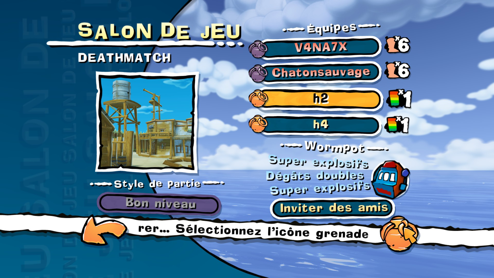
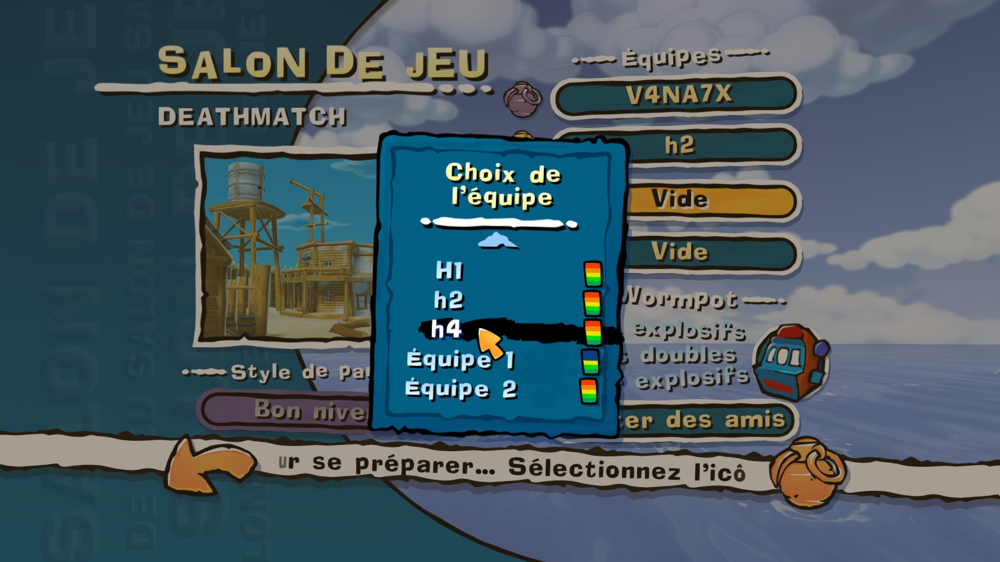

# WORMS-Ultimate-Mayhem-OnlineBots

**Français** · [English](#english)

Mod pour **Worms Ultimate Mayhem** (Steam) : jouez en ligne avec les équipes IA du jeu en plus de vos amis, en équipes, avec le nombre de vers de votre choix.



## Fonctionnalités

- **IA en ligne** : l'hôte ajoute dans le lobby en ligne des équipes CPU de sa caserne, avec leur vrai nom et leur icône de difficulté.
  - **Clic sur une ligne libre** : ouvre la liste des équipes CPU pour en choisir une.
  - Les IA jouent chez tous les joueurs, partie et revanche comprises.
- **Équipes et nombre de vers en ligne**, comme en partie locale : l'hôte clique sur une équipe déjà présente (un joueur ou une IA) et retrouve la fenêtre du jeu local :
  - **nombre de vers** : 1 à 6 par équipe, 16 au total au maximum ;
  - **couleur d'alliés** : les équipes de même couleur jouent ensemble, par exemple les humains contre les IA ;
  - **handicap** : bonus ou malus de vie ;
  - **Enlever une équipe** : retire l'IA, ou exclut le joueur.
  - Le lobby affiche tout comme en local : nom dans la couleur d'alliés, icône du handicap, tête de ver (niveau de l'IA) et « ×N ». Les réglages de l'hôte s'appliquent chez tous les joueurs.
- **Wormpot en multijoueur** : avec le seul mod de Woitek1993, chaque joueur doit régler exactement le même Wormpot, sinon la partie plante. Ici, **seul l'hôte le règle** : ses 3 rouleaux sont envoyés automatiquement aux autres joueurs, et s'affichent chez eux, à chaque partie et à chaque revanche.
- **Voix française complète** et correctifs communautaires (pack complet, option B).

## Installation

Téléchargez le dépôt (**Code → Download ZIP**), puis copiez les fichiers **jeu fermé** dans le dossier du jeu (`...\steamapps\common\WormsXHD\`). **Tous les joueurs doivent avoir la même installation.**



### Option A — IA en ligne seulement (2 ou 3 fichiers du dépôt)

| Fichier | Rôle |
|---|---|
| `dinput8.dll` | [Ultimate ASI Loader](https://github.com/ThirteenAG/Ultimate-ASI-Loader/releases) (32 bits) : charge les plugins `.asi` |
| `plugins\WUMMod.asi` | le mod : IA en ligne et synchro du Wormpot |
| `Data\Tweak\MENUTWKXNET.XOM` | *(optionnel)* bouton Wormpot dans le lobby en ligne, tiré du mod « Wormpot for Multiplayer » de Woitek1993 |

Aucun fichier du jeu n'est remplacé, sauf `MENUTWKXNET.XOM` si vous ajoutez le Wormpot. Le mod neutralise lui-même le contrôle d'intégrité du jeu, donc ce fichier modifié ne le fait pas planter.

### Option B — Pack complet : IA, Wormpot, voix française et correctifs (tout le dépôt sauf `src\`)

Copiez **tout** le contenu du dépôt (sauf `src\` et ce README) à la racine du jeu, en écrasant les fichiers existants :

| Fichier ou dossier | Rôle | Remplace un fichier du jeu |
|---|---|---|
| `dinput8.dll` | Ultimate ASI Loader | non |
| `plugins\WUMMod.asi` | IA en ligne et synchro du Wormpot | non |
| `plugins\WUM.Loader.asi` | charge les fichiers de `Data2\` à la place des originaux | non |
| `plugins\WUM.Patch.asi` + `WUM.Patch.ini` | correctifs communautaires : toutes les langues, objets de fidélité, fenêtre sans bord… | non |
| `Data2\` | fichiers chargés par WUM.Loader (`Bundl09.xom`, menus sans Marketplace) | non |
| `Data\Tweak\MENUTWKXNET.XOM` | Wormpot dans le lobby en ligne | **oui** |
| `Data\Tweak\LOCAL.XOM` | ajoute la voix « Français » à la liste des voix | **oui** |
| `Data\Tweak\WORMACTING.XOM` | répliques en plus dans les animations | **oui** |
| `Data\Language\PC\FreFE.xom`, `EngFE.xom` | libellé « Français » / « French » de la voix | **oui** |
| `Data\Audio\PC\WormsX.fev` + 217 `.fsb` | table et banques son du même build FMOD, obligatoires ensemble | **oui** |
| `Data\Audio\Speech\vofrench.lsd` | répliques de la voix française | **oui** |
| `speech\vofrench\LIP.txt` | synchro des lèvres | **oui** |
| `CG\*.cg` | shaders | **oui** |

Dans le jeu, choisissez ensuite la voix **Français** dans les options de l'équipe.

**Sauvegardez votre dossier de jeu** avant l'option B. Une « vérification de l'intégrité des fichiers » Steam remet les fichiers d'origine : il suffit alors de recopier le pack. L'option A n'est pas concernée, à part le Wormpot.

## Utilisation

1. L'hôte crée une partie en ligne personnalisée.
2. Il clique sur une ligne libre du lobby et choisit une équipe CPU. Il recommence pour chaque IA, jusqu'à 4 équipes au total.
3. *(Optionnel)* Il clique sur une équipe (la sienne, celle d'un ami ou une IA) pour régler ses vers, sa couleur d'alliés et son handicap, puis **Accepter**.
4. *(Optionnel)* Il règle le Wormpot.
5. Les amis rejoignent et la partie se lance normalement.

Le niveau d'une IA est celui choisi à la création de l'équipe CPU dans la caserne.

## Limites

- Uniquement la **version Steam, build 1077** (`WormsMayhem.exe` 32 bits). Sur une autre version, le mod reste inactif.
- **Seul l'hôte** ajoute ou retire des IA et règle les équipes. Les IA viennent de **sa** caserne ; les invités ne voient pas les lignes IA dans le lobby, mais elles sont bien présentes en partie.
- Si l'hôte quitte la partie, elle s'arrête pour tout le monde, comme dans le jeu d'origine.
- Usage entre amis, sans garantie. Le fichier `.exe` du jeu n'est pas modifié : tout se fait en mémoire.

## Voix française

Adaptation par **jiangwei4** à partir des voix françaises de **Worms 4 : Mayhem** (Team17). Certaines banques son proviennent d'un pack communautaire dont l'auteur est inconnu ; s'il se reconnaît, qu'il nous contacte pour être crédité.

Fichiers de la voix : voir l'option B (`LOCAL.XOM`, `FreFE.xom`/`EngFE.xom`, `WormsX.fev` et `.fsb`, `vofrench.lsd`, `LIP.txt`).

## Compilation

Sources dans `src\` — MinGW 32 bits (`src\build.bat`) :

```
gcc -std=gnu99 -O2 -shared -s -DWUM_NOLOG -o WUMMod.asi wummod.c -static-libgcc
```

Sans `-DWUM_NOLOG`, vous obtenez une version de diagnostic qui écrit `wummod_log.txt` à la racine du jeu.

## Crédits

- **WUM-Mod (IA en ligne, équipes et vers en ligne, synchro du Wormpot)** : jiangwei4
- **Interface Wormpot multijoueur** : Woitek1993, mod « Wormpot for Multiplayer »
- **Ultimate ASI Loader** : ThirteenAG
- **WUM.Loader / WUM.Patch** (pack complet) : auteurs de la communauté WUM
- **Voix française** : jiangwei4, d'après Worms 4 : Mayhem (Team17), plus des banques son d'un pack communautaire d'auteur inconnu
- Worms Ultimate Mayhem © Team17. Ce projet n'est ni affilié à Team17 ni approuvé par Team17.

---

## English

A mod for **Worms Ultimate Mayhem** (Steam): play online with the game's AI teams alongside your friends, in teams, with the number of worms you want.


### Features

- **Online AI**: the host adds CPU teams from their barracks to the online lobby, with their real names and difficulty icon.
  - **Click an empty slot**: opens the CPU team list so you can pick one.
  - The AI plays on every player's PC, including rematches.
- **Online teams and worm count**, as in local games: the host clicks a team already in the lobby (a player or an AI) and gets the local game's window:
  - **number of worms**: 1 to 6 per team, 16 in total at most;
  - **ally colour**: teams with the same colour play together, for example humans against the AI;
  - **handicap**: health bonus or penalty;
  - **Remove team**: removes the AI, or kicks the player.
  - The lobby shows everything as in local games: name in the ally colour, handicap icon, worm head (AI skill) and "×N". The host's settings apply on every player's PC.
- **Multiplayer Wormpot**: with Woitek1993's mod alone, every player must set exactly the same Wormpot, or the game crashes. Here, **only the host sets it**: their 3 reels are sent automatically to the other players and shown on their screens, for every game and every rematch.
- **Full French voice pack** and community fixes (full pack, option B).

### Installation

Download the repository (**Code → Download ZIP**), then copy the files **with the game closed** into the game folder (`...\steamapps\common\WormsXHD\`). **Every player must have the same setup.**


#### Option A — Online AI only (2 or 3 files from the repository)

| File | Purpose |
|---|---|
| `dinput8.dll` | [Ultimate ASI Loader](https://github.com/ThirteenAG/Ultimate-ASI-Loader/releases) (32-bit): loads `.asi` plugins |
| `plugins\WUMMod.asi` | the mod: online AI and Wormpot sync |
| `Data\Tweak\MENUTWKXNET.XOM` | *(optional)* Wormpot button in the online lobby, from Woitek1993's "Wormpot for Multiplayer" mod |

No game file is replaced, except `MENUTWKXNET.XOM` if you add the Wormpot. The mod disables the game's integrity check itself, so this modified file does not crash the game.

#### Option B — Full pack: AI, Wormpot, French voice and fixes (whole repository except `src\`)

Copy **everything** in the repository (except `src\` and this README) to the game root, overwriting existing files:

| File or folder | Purpose | Replaces a game file |
|---|---|---|
| `dinput8.dll` | Ultimate ASI Loader | no |
| `plugins\WUMMod.asi` | online AI and Wormpot sync | no |
| `plugins\WUM.Loader.asi` | loads the files in `Data2\` instead of the originals | no |
| `plugins\WUM.Patch.asi` + `WUM.Patch.ini` | community fixes: all languages, loyalty items, borderless window… | no |
| `Data2\` | files loaded by WUM.Loader (`Bundl09.xom`, menus without Marketplace) | no |
| `Data\Tweak\MENUTWKXNET.XOM` | Wormpot in the online lobby | **yes** |
| `Data\Tweak\LOCAL.XOM` | adds the "French" voice to the voice list | **yes** |
| `Data\Tweak\WORMACTING.XOM` | extra lines in the animations | **yes** |
| `Data\Language\PC\FreFE.xom`, `EngFE.xom` | "Français" / "French" voice label | **yes** |
| `Data\Audio\PC\WormsX.fev` + 217 `.fsb` | sound table and banks from the same FMOD build, required together | **yes** |
| `Data\Audio\Speech\vofrench.lsd` | French voice lines | **yes** |
| `speech\vofrench\LIP.txt` | lip sync | **yes** |
| `CG\*.cg` | shaders | **yes** |

Then, in the game, select the **French** voice in the team options.

**Back up your game folder** before option B. A Steam "verify integrity of game files" restores the original files: just copy the pack again. Option A is not affected, apart from the Wormpot.

### Usage

1. The host creates a custom online game.
2. The host clicks an empty lobby slot and picks a CPU team. Repeat for each AI, up to 4 teams in total.
3. *(Optional)* The host clicks a team (their own, a friend's or an AI) to set its worms, ally colour and handicap, then **Accept**.
4. *(Optional)* The host sets the Wormpot.
5. Friends join and the game starts as usual.

An AI's skill level is the one set when the CPU team was created in the barracks.

### Limitations

- **Steam version, build 1077 only** (32-bit `WormsMayhem.exe`). On any other version, the mod stays inactive.
- **Only the host** can add or remove AI teams and set the teams. The AI teams come from **the host's** barracks; guests don't see the AI rows in the lobby, but the teams are present in the game.
- If the host leaves, the game ends for everyone, as in the original game.
- For playing with friends, no warranty. The game's `.exe` file is not modified: everything happens in memory.

### French voice pack

Adapted by **jiangwei4** from the French voices of **Worms 4: Mayhem** (Team17). Some sound banks come from a community pack whose author is unknown; if that's you, please get in touch so we can credit you.

Voice files: see option B (`LOCAL.XOM`, `FreFE.xom`/`EngFE.xom`, `WormsX.fev` and `.fsb`, `vofrench.lsd`, `LIP.txt`).

### Building

Sources in `src\` — MinGW 32-bit (`src\build.bat`):

```
gcc -std=gnu99 -O2 -shared -s -DWUM_NOLOG -o WUMMod.asi wummod.c -static-libgcc
```

Without `-DWUM_NOLOG`, you get a diagnostic build that writes `wummod_log.txt` to the game root.

### Credits

- **WUM-Mod (online AI, online teams and worm count, Wormpot sync)**: jiangwei4
- **Multiplayer Wormpot UI**: Woitek1993, "Wormpot for Multiplayer" mod
- **Ultimate ASI Loader**: ThirteenAG
- **WUM.Loader / WUM.Patch** (full pack): WUM community authors
- **French voice pack**: jiangwei4, based on Worms 4: Mayhem (Team17), plus sound banks from a community pack whose author is unknown
- Worms Ultimate Mayhem © Team17. This project is not affiliated with or endorsed by Team17.
